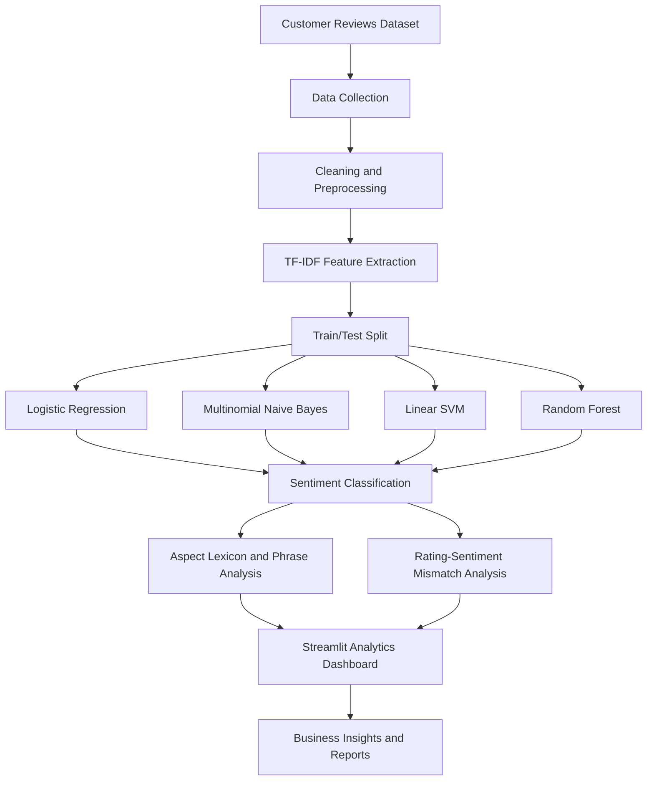
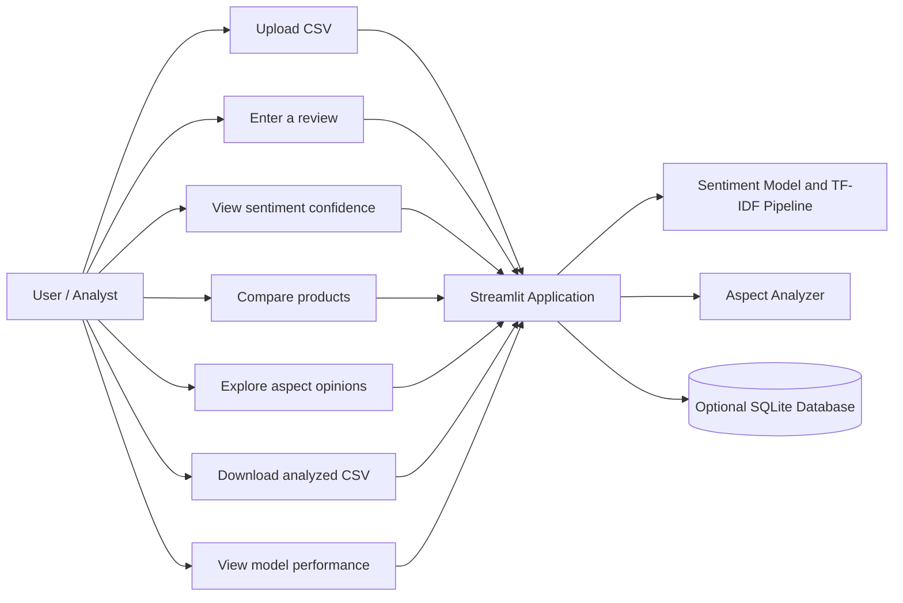

# System Architecture

## UML Use Case

## Component Responsibilities

- `src/preprocessing.py`: cleaning, deduplication, split-safe text preparation.
- `src/train_models.py`: model training and evaluation.
- `src/aspect_analysis.py`: aspect lexicons and opinion extraction.
- `src/predict.py`: loading artifacts and producing predictions.
- `app/app.py`: interactive dashboard.
- `data/`: raw and processed datasets.
- `models/`: trained artifacts and evaluation outputs.
- `reports/`: figures and academic report source outputs.
- `presentation/`: PowerPoint source and assets.
